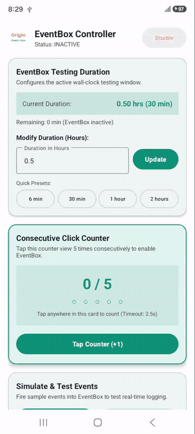

# Event Box

[](https://jitpack.io/#JpOriginDev/event-box)
[](LICENSE)
[](#1-add-the-dependency)
[](#4-log-your-events)

A floating on-screen log for Android testers. A small bubble sits on top of your app; tap it to
open a panel that shows your analytics events as they fire, so you don't have to watch logcat.

<!-- TODO: record a short GIF (10-15 s) and save it as docs/demo.gif -->
<p align="center">
  
</p>

Think of it as **Firebase DebugView on the device itself**: no adb, no USB cable, no logcat filters.

- For testing only: it can be switched off completely and records nothing while off.
- No permissions needed (the background overlay is optional and opt-in).
- `minSdk 21`, pure Kotlin, works from Java too.

## Why use Event Box?

**The problem:** checking analytics events means plugging in a cable, filtering logcat or setting up
DebugView. Testers can't do it on their own phones, and wrong events (bad names, too many
parameters) are often found only after release.

**Event Box fixes that:**

| Who | How it helps |
|---|---|
| **QA and testers** | See every event live on the phone, in the real build, with no cable or tools. |
| **Android developers** | Verify that the right event fires with the right parameters while you build a feature. |
| **Analytics and product teams** | Check a release flow end to end and catch tracking mistakes before users do. |
| **Teams using Firebase Analytics** | Get an instant ⚠ warning when an event breaks a Firebase limit. |

## Features

- **Live event log**: events appear as they fire, with number, time, name and parameters.
- **Floating bubble and panel**: drag it anywhere, it snaps to the screen edge, shows an unread
  badge, and shrinks back on its own.
- **Firebase limit warnings**: a ⚠ icon on any event that breaks a Firebase Analytics rule, with
  the exact reason on tap.
- **Resizable, pinnable panel**: drag the bottom handle to change the height, pin to keep it open.
- **Background overlay** (optional): keep the box visible when your app is in the background or in
  recents (`OFF`, `AUTO`, `OVERLAY_ONLY`).
- **Safe by design**: a kill switch, a timed session that ends by itself, and logging that never
  throws into your app.
- **Simple API**: fluent setup, `log()` with a name, a `Bundle` or a `Map`, plus user properties.
- **Customizable bubble**: your own icon, colors, border and corner radius.
- **Reactive**: read events and state as Kotlin `StateFlow`.
- **Kotlin and Java**: both are supported, with its own R8 rules built in.

## 1. Add the dependency

In `settings.gradle.kts`:

```kotlin
dependencyResolutionManagement {
    repositories {
        google()
        mavenCentral()
        maven("https://jitpack.io")
    }
}
```

In your app's `build.gradle.kts`:

```kotlin
dependencies {
    implementation("com.github.JpOriginDev:event-box:1.2.1")
}
```

The library supports compileSdk 36+ and AGP 9.0+.

## 2. Set it up

Call this once in your `Application.onCreate()`:

**Kotlin**
```kotlin
OGEventBoxLog.setDebugModeEnabled(BuildConfig.DEBUG)
    .setDebugModeDurationHours(0.5)
    .install(this)
```

**Java**
```java
OGEventBoxLog.setDebugModeEnabled(BuildConfig.DEBUG)
    .setDebugModeDurationHours(0.5)
    .install(this);
```

- `setDebugModeEnabled` is your kill switch. When `false`, the box can never appear.
- `setDebugModeDurationHours` is how long a session lasts (here, 30 minutes).

## 3. Turn it on

Setup alone shows nothing. Your app must also switch it on, for example from a hidden gesture
(five taps on a title) or a debug menu:

```kotlin
OGEventBoxLog.setEnabled(context, true)
```

The session then runs for the duration you set, and turns itself off when time is up. The bubble
comes back if the app is closed and reopened during the session.

## 4. Log your events

**Kotlin**
```kotlin
// Simple event
OGEventBoxLog.log("user_signed_in")

// Event with Bundle parameters (Firebase Analytics style)
val bundle = Bundle().apply {
    putString("item_id", "sku_101")
    putDouble("price", 29.99)
}
OGEventBoxLog.log("purchase", bundle)

// Event with Map parameters
OGEventBoxLog.log("item_selected", mapOf("item_name" to "Sneakers"))

// User property
OGEventBoxLog.setUserProperty("user_tier", "premium")
```

**Java**
```java
// Simple event
OGEventBoxLog.log("user_signed_in");

// Event with Bundle parameters
Bundle bundle = new Bundle();
bundle.putString("item_id", "sku_101");
OGEventBoxLog.log("purchase", bundle);

// Event with Map parameters
Map<String, Object> params = new HashMap<>();
params.put("item_name", "Sneakers");
OGEventBoxLog.log("item_selected", params);

// User property
OGEventBoxLog.setUserProperty("user_tier", "premium");
```

Log each event once. Calls are ignored while the box is off, and logging never throws into your
app.

### Firebase Limits & Validation Warnings

EventBox automatically checks each logged event against Firebase Analytics rules:
1. **Distinct Event Names**: Up to 500 distinct custom event types per app.
2. **Event Name Length**: Max 40 characters (alphanumeric and underscores).
3. **Parameters Per Event**: Max 25 unique parameters per event.
4. **Parameter Name Length**: Max 40 characters (alphanumeric and underscores).
5. **Parameter Value Length**: Max 100 characters (Standard GA).
6. **User Properties**: Max 25 per app (names ≤ 24 chars, values ≤ 36 chars).
7. **Daily Event Volume**: Warns when approaching ~100,000 events/user/day throttle.

If an event violates any condition, a warning icon (**⚠**) appears at the end of its item row. Tapping the warning icon smoothly expands the item to display the full event name and the exact limit violation reason. Clicking another warning icon smoothly collapses the currently open item before expanding the new one.

#### Enabling or Disabling Firebase Checks

By default, Firebase checks are enabled (`true`). You can disable or enable them anytime via fluent setter:

**Kotlin**
```kotlin
OGEventBoxLog.setFirebaseChecksEnabled(false)
```

**Java**
```java
OGEventBoxLog.setFirebaseChecksEnabled(false);
```

#### Enabling or Disabling Panel Height Resizing

By default, panel height resizing is enabled (`true`). When enabled, a resize icon appears in the header; tapping it blinks the bottom-edge handle twice to indicate where to drag. Users can drag the bottom handle up or down to adjust the panel height while keeping the width fixed.

When resizing is disabled, the header resize icon and the bottom drag handle are hidden, preventing all panel resizing.

**Kotlin**
```kotlin
OGEventBoxLog.setPanelResizingEnabled(false)
```

**Java**
```java
OGEventBoxLog.setPanelResizingEnabled(false);
```

## Using the box

- **Bubble**: tap to open the panel, drag to move it. It snaps to the left or right edge and fades
  when idle. The badge shows how many events arrived since you last opened the panel.
- **Panel**: shows `number  time  event_name`, newest at the bottom. It shrinks back to the bubble
  after 6 seconds without touch.
    - **Resize icon**: tap to blink the bottom-edge drag handle twice to guide where to drag.
      While you drag the handle up or down, its bar widens and lights up.
    - **Warning icon**: tap to smoothly expand/collapse Firebase limit warnings.
    - **Pin**: stops it from auto-shrinking.
    - **Minimize** (or tap the logo): shrinks it now.
    - **CLEAR**: empties the log.
- **Close**: drag the box toward the bottom of the screen and drop it on the close target to end
  the session.

## Customize the bubble (optional)

Call these before `install()`:

```kotlin
OGEventBoxLog.setBubbleIconResId(R.mipmap.my_logo)
    .setBubbleIconScaleType(ImageView.ScaleType.CENTER_CROP)
    .setBubbleBackgroundColor(Color.parseColor("#0D9379"))
    .setBubbleBorderColor(Color.parseColor("#CCE6E1"))
    .setBubbleBorderWidthDp(1.5f)
    .setBubbleCornerRadiusDp(-1f) // -1 = fully round
    .setDebugModeEnabled(BuildConfig.DEBUG)
    .setDebugModeDurationHours(0.5)
    .install(this)
```

## Keep it visible in the background (optional)

By default the box shows only while one of your Activities is in front. To keep it visible in the
background and in recents, pick a mode and ask the user for "Display over other apps":

```kotlin
OGEventBoxLog.setBackgroundMode(OGEventBoxBackgroundMode.AUTO)

if (!OGEventBoxLog.hasOverlayPermission(context)) {
    OGEventBoxLog.requestOverlayPermission(context) // opens the system settings screen
}
```

| Mode | Behaviour |
|---|---|
| `OFF` (default) | Activity window only. No permission needed. |
| `AUTO` | Activity window in front. Moves to a system overlay in the background if the permission is granted, otherwise hides. |
| `OVERLAY_ONLY` | Always the system overlay; hidden while the permission is missing. |

The permission is checked live, so granting or revoking it takes effect without restarting. The
library never opens the settings screen by itself. The overlay lasts only while your app's process
is alive; Android may stop a backgrounded process.

The library does not declare `SYSTEM_ALERT_WINDOW`. Add it to your own app's manifest, ideally in
`src/debug/AndroidManifest.xml` so it stays out of release builds:

```xml
<uses-permission android:name="android.permission.SYSTEM_ALERT_WINDOW" />
```

Without it, `hasOverlayPermission()` returns `false` and the box behaves as with `OFF`.

## Other controls

| Call | What it does |
|---|---|
| `OGEventBoxLog.setFirebaseChecksEnabled(enabled)` | Enables or disables Firebase limits checks |
| `OGEventBoxLog.setPanelResizingEnabled(enabled)` | Enables or disables panel height resizing |
| `OGEventBoxLog.setBackgroundMode(mode)` | Keeps the box visible in the background: `OFF`, `AUTO` or `OVERLAY_ONLY` |
| `OGEventBoxLog.hasOverlayPermission(context)` | Is "Display over other apps" granted? |
| `OGEventBoxLog.requestOverlayPermission(context)` | Opens the system screen to grant it |
| `OGEventBoxLog.disable()` | Ends the session now |
| `OGEventBoxLog.updateDebugModeDurationHours(context, 1.0)` | Changes the session length |
| `OGEventBoxLog.isActive` | Is the box on? (`Boolean`) |
| `OGEventBoxLog.isActiveFlow` | Same, as a `StateFlow<Boolean>` |
| `OGEventBoxLog.remainingMinutes(context)` | Minutes left (0 when off) |
| `OGEventBoxLog.events` | The log as `StateFlow<List<OGEventBoxDebugEvent>>` (max 200) |
| `OGEventBoxLog.clear()` | Empties the log |
| `OGEventBoxLog.setUserProperty(name, value)` | Records a user property (checked against Firebase limits) |

## Release builds

Nothing extra is needed. The library ships its own ProGuard/R8 rules and keeps only the public API
(`OGEventBoxLog`, `OGEventBoxDebugEvent`, `OGEventBoxBackgroundMode`, `OGEventBoxValidator`). Your app's own R8 obfuscates the
rest.

The box shows event names and parameters on screen, which may include user data. Always gate it with
`setDebugModeEnabled(BuildConfig.DEBUG)` and never enable it for end users.

## Known limits

- The background overlay needs `SYSTEM_ALERT_WINDOW` in your app and only lasts while Android keeps
  your process alive.
- The bubble sits on the left or right edge; its window is as wide as the bubble while collapsed,
  so it never blocks touches elsewhere.
- A dialog opened later briefly covers the box (about 150 ms) before it lifts back on top.
- The box re-adds itself when the notification shade or keyboard takes focus, which restarts the
  auto-shrink timer.

## License

MIT, see [`LICENSE`](LICENSE). Third-party notices (Material Icons, Apache-2.0) are in
[`NOTICE`](NOTICE). Not affiliated with or endorsed by Google; the Firebase limits checked are
best-effort and may change.

## More

How the code is organized: [`eventBox/ARCHITECTURE.md`](eventBox/ARCHITECTURE.md)
